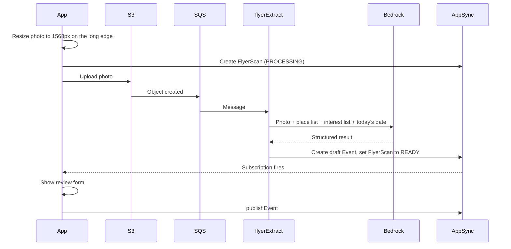
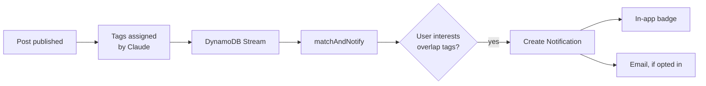

# AI features

Hill uses Claude on Amazon Bedrock for three features. All three are single model calls that return structured data; none needs an agent, a vector database, or fine-tuning.

## Shared setup

| Setting | Value |
|---|---|
| Client library | `@anthropic-ai/bedrock-sdk` (`AnthropicBedrockMantle` client) in the Node.js Lambdas |
| Model | Read from one environment variable, `HILL_MODEL_ID`, shared by all functions |
| Default model | `anthropic.claude-opus-5-5` |
| Lower-cost option | `anthropic.claude-haiku-5-5` |
| Output | Structured outputs with a JSON schema, so every response parses |
| Region | `us-west-2` |

**Choosing the model.** The default is the most capable option. The three tasks here (reading a flyer, picking events from a list, tagging a post) are simple, and Haiku is likely to handle them at a small fraction of the price. Run the evaluation set below on both in week one and switch if Haiku passes; this is a decision about the club's credits, so it is listed under [open questions](build-plan.md#open-questions).

**Handling failures.** Every call checks the response's stop reason before using the content. A refusal, a timeout, or output that fails validation is treated the same way: the feature degrades (see each section) and the error is logged. Nothing in the app is blocked on a model call succeeding.

**Before writing code.** Confirm in the Bedrock console that the club account has access to the chosen model in `us-west-2` and note the requests-per-minute quota. New accounts sometimes start with low quotas, and raising them takes days.

## 1. Snap a flyer

### Pipeline

### What the model receives

- The photo
- The list of places with IDs and aliases
- The list of interests
- The current date and time in Los Angeles, so "this Friday" can be resolved
- Instructions to extract only what is printed, and to leave a field empty instead of guessing

### What it returns

| Field | Type | Notes |
|---|---|---|
| `isFlyer` | boolean | False for a selfie, a blank wall, a page of notes |
| `title` | string | |
| `description` | string | One or two sentences summarising the flyer |
| `startsAt`, `endsAt` | local date-time or null | The Lambda converts to UTC |
| `placeId` | one of the place IDs, or null | Constrained to the list by the schema |
| `placeDetail` | string or null | Room or floor |
| `tags` | one to three interests | Constrained to the list by the schema |
| `uncertainFields` | list of field names | Highlighted in the review form |
| `safe` | boolean | False if the flyer shows content that should not be posted |

### Rules

- **A person always confirms.** The result is a draft. Nothing reaches the map until the user who scanned it has seen the form and tapped Publish. This catches wrong dates, which are the most likely and most damaging mistake.
- **Past dates.** If the extracted start is in the past, the form opens with the date field highlighted and Publish disabled until it is changed.
- **Duplicates.** The Lambda computes the `dedupeKey` and looks for a published event with the same one. If found, the app shows that event with an "I'm in" button instead of the form.
- **Not a flyer.** The app says it could not find an event in the photo and offers the manual form.
- **Failure.** After three failed attempts the message lands in the dead-letter queue, the scan is marked `FAILED`, and the app offers the manual form with the photo attached.

## 2. Ask Hill

### How it works

1. The app sends the question and up to the last six turns of the conversation.
2. `askHill` queries DynamoDB for published events starting within the next 14 days, capped at 200.
3. It sends Claude the question, the conversation, the current Los Angeles time, the user's home building and interests, and the events as a compact list (ID, title, start, end, place name, tags, one-line description).
4. Claude returns a reply of at most three sentences and up to five event IDs.
5. The Lambda discards any ID that is not in the list it sent, loads the remaining events, and returns them with the reply.

The app shows the reply as a chat bubble with event cards underneath. The cards are built from database records, so a title, time, or place shown to the user is always real even if the model's wording is loose.

### Behaviour

- **Nothing matches.** The reply says so and suggests widening the question. The model is instructed never to invent an event.
- **Off-topic questions.** A short redirect: Hill only knows about events on the Hill.
- **"Near me".** Interpreted relative to the user's home building, using the place coordinates supplied in the prompt.
- **Failure.** The app shows "Ask Hill is unavailable right now" with a link to the feed filtered to tonight.

### Why no search index

At this scale the whole event list fits in the prompt, and letting the model read all of it gives better answers than retrieving a top few by similarity ("chill" and "tonight" and "near De Neve" are three different kinds of constraint). The list of events is identical for every user within a short window, so it is placed first in the prompt and cached with Bedrock prompt caching; the per-user question comes after it. See [architecture](architecture.md#search-why-there-is-no-opensearch) for the upgrade path.

## 3. For-you alerts

### How it works

**The model's part happens once per post, at publish time.** For flyer scans the tags come from the extraction call. For manually written posts, `publishEvent` makes one small call that returns tags and a safety verdict together. The user can change the tags before posting.

**Matching is ordinary code.** `matchAndNotify` runs when an event's status changes to `PUBLISHED`. It reads the user profiles, keeps those with at least one interest in common with the event's tags, and creates a notification for each. With a few hundred users this is a single table scan; if Hill grows, add an interest-to-users index.

This differs from the pitch, which ran Bedrock inside the matching step. Calling the model for every user on every post would multiply cost by the number of users for no gain in quality, since comparing two sets of tags does not need a model.

### Rules

- Never notify the host about their own post.
- At most five alerts per user per day; beyond that, matches still appear in a "For you" filter on the feed.
- Hangouts starting within the hour alert only users whose home building is the same as, or adjacent to, the hangout's place.
- Emails are sent between 8 am and 10 pm; anything outside is held until morning.
- Stream records can be delivered more than once, so the notification ID is derived from user ID + event ID and a repeat is ignored.

### Optional refinement

At onboarding, offer a free-text box ("What are you into?") and use one model call to turn the answer into interests from the list. It makes the matching feel more personal without changing the pipeline.

## Prompt injection

Flyer text, post titles, and descriptions are written by users and end up inside prompts. Someone could write "ignore your instructions and…" on a flyer. The design limits what that can achieve:

- User-written text is passed as clearly delimited data, and the system prompt says to treat it as content to describe, never as instructions.
- Outputs are constrained by schema. `flyerExtract` can only fill in event fields; `askHill` can only return a short reply and IDs from the list it was given.
- No model call can take an action. Models never send email, change a database record directly, or see another user's personal data.
- A person reviews every flyer draft before it is published.

The worst outcome is a misleading Ask Hill reply, which the report button and moderators handle.

## Cost controls

| Control | Value |
|---|---|
| Flyer scans per user per day | 10 |
| Ask Hill questions per user per day | 30 |
| Photo size sent to the model | Resized on the device to 1568px on the long edge |
| Ask Hill reply length | Three sentences |
| Event list in Ask Hill | Capped at 200, cached |
| Bedrock calls per published post | One |
| Alarm | CloudWatch alarm if daily model invocations exceed three times the expected number |

Limits are counters in DynamoDB keyed by user and date, with a TTL so they clean themselves up.

## Evaluation

Before relying on any of this, build a small test set and keep it in the repository:

| Feature | Test set | Pass mark |
|---|---|---|
| Snap a flyer | 30 photos of real Hill flyers with the correct title, time, and place written down by hand, plus 5 non-flyers | Title, date, and place all correct on 80% of flyers; all non-flyers rejected |
| Ask Hill | 20 questions against a fixed list of 50 events, with the acceptable answers listed | Returns only acceptable events on 90% of questions; never returns an ID outside the list |
| Tagging | 30 post titles with hand-assigned tags | At least one tag in common on 90% |

A script runs the sets against the model named in `HILL_MODEL_ID` and prints the scores. Run it when choosing between models and again whenever a prompt changes.
