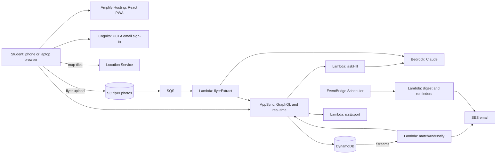

# Architecture

## Recommendation

| Layer | Choice |
|---|---|
| Language | TypeScript everywhere |
| Frontend | React 19 + Vite, installable PWA, MapLibre GL JS for the map |
| Backend definition | AWS Amplify Gen 2 (backend resources declared in TypeScript under `amplify/`) |
| Custom backend code | Node.js 22 Lambda functions |
| Region | `us-west-2` (Oregon): closest region to UCLA with full Bedrock model availability |

This is the Node.js + React stack you had in mind, with one adjustment: the Node.js code runs as Lambda functions behind AppSync instead of as an Express server. The reasons are in [Alternatives considered](#alternatives-considered).

## System diagram

## AWS services

### Core: needed for v1

| Service | Job in Hill | Notes |
|---|---|---|
| **Amplify Hosting** | Builds and serves the React app from the Git repo; a preview URL per pull request | Includes a CDN and HTTPS, so no separate CloudFront setup |
| **Amplify Gen 2** | Defines auth, data, storage, and functions in TypeScript; gives each developer a private cloud sandbox (`npx ampx sandbox`) | It generates CloudFormation through CDK, so anything Amplify does not cover can be added in plain CDK in the same project |
| **Cognito** | Sign-up, sign-in, emailed confirmation code | A pre-sign-up Lambda trigger rejects any address not ending in `@ucla.edu` or `@g.ucla.edu`. A `moderators` group gates the moderation tools |
| **AppSync** | GraphQL API. Subscriptions push new posts to every open app | This is what makes "posts appear instantly" work with no WebSocket code of your own |
| **DynamoDB** | All application data | On-demand billing. TTL deletes expired hangouts and old notifications automatically. Streams trigger the alert pipeline |
| **S3** | Flyer photos | Browser uploads directly with a short-lived signed URL. A lifecycle rule deletes unpublished scans after seven days |
| **SQS** | Buffer between a flyer upload and the extraction Lambda | Gives retries and a dead-letter queue, so a Bedrock hiccup does not lose a scan |
| **Lambda** | All custom logic, five functions (below) | Node.js 22, one function per job |
| **Bedrock** | Claude for reading flyers, answering Ask Hill, tagging and screening posts | See [AI features](ai-features.md) |
| **Location Service** | Map tiles for the live map | Rendered with MapLibre GL JS using a Location Service API key. Places come from Hill's own list, so no geocoding calls are needed |
| **SES** | Alert emails, and Cognito's confirmation emails | Two things need doing on day one; see [Risks](build-plan.md#risks) |
| **CloudWatch** | Logs and alarms | Alarm on the SQS dead-letter queue and on Lambda errors |
| **AWS Budgets** | Spend alerts on the club credits | Set alerts at 25%, 50%, and 80% of the credit amount before anything else is deployed |

### Stretch

| Service | Job | When |
|---|---|---|
| **EventBridge Scheduler** | Weekly digest (recurring schedule) and per-user event reminders (one-off schedules) | When the digest or reminders are built |
| **Web Push** (not an AWS service) | Lock-screen notifications from a Lambda using the `web-push` library, keys held in Secrets Manager | After in-app alerts work. On iPhone, web push only works once the user has added the app to their home screen |
| **S3 Vectors + Titan Text Embeddings** | Semantic search across a larger archive of events | Only if the event count outgrows a single prompt. Confirm regional availability first |
| **Bedrock Guardrails** | Managed content filter in front of model calls | If prompt-based screening proves too loose |

### Lambda functions

| Function | Trigger | Does |
|---|---|---|
| `preSignUp` | Cognito | Rejects non-UCLA email domains |
| `flyerExtract` | SQS (fed by S3 uploads) | Sends the photo to Bedrock, writes a draft event |
| `askHill` | AppSync query | Loads upcoming events, asks Bedrock, returns a reply and event IDs |
| `matchAndNotify` | DynamoDB Stream on the Event table | Finds users whose interests match a newly published post, creates notifications, sends email |
| `icsExport` | AppSync query | Returns an `.ics` file for an event |

## Considered and left out

### Search: why there is no OpenSearch

The pitch uses OpenSearch for plain-English search. This spec drops it for the pilot.

- **Scale.** The Hill produces tens of events a week. Two weeks of upcoming events, written compactly, is a few thousand words. That fits comfortably in a single model prompt, so `askHill` can hand Claude the whole list and let it pick. No index, no embeddings, nothing to keep in sync.
- **Cost.** Everything else in this design costs nothing when nobody is using it. An OpenSearch domain or Serverless collection bills around the clock whether or not anyone searches, and that fixed charge would be the largest line on the bill. Check the current pricing page before reconsidering it.
- **Time.** It is another service to secure, populate, and debug in a three-week build.

If Hill grows to thousands of events, the upgrade path is embeddings stored in S3 Vectors, which keeps the pay-per-use property.

### SNS

SNS mobile push delivers to native apps through Apple's and Google's push services. Hill v1 is a web app, which uses the Web Push standard instead, and SNS does not speak it. SNS text messages would work but cost money per message and require sender registration that takes longer than the project. SNS returns to the design if a native app is built.

### Others

| Service | Why not |
|---|---|
| Textract | Claude reads the flyer image and structures the result in one call; Textract would add a step and still need a model to interpret the text |
| Rekognition | Image moderation is folded into the same Claude call that reads the flyer |
| Bedrock Knowledge Bases | Designed for retrieval over large document sets and needs a vector store behind it; unnecessary at this scale |
| API Gateway | AppSync is the API |
| RDS / Aurora | A relational database is a reasonable fit for this data, but it has a running cost and needs network setup. DynamoDB is free at idle |

## Alternatives considered

### Express server on Node.js with a REST API

The most familiar shape for a Node.js + React team: an Express app in a container on App Runner or ECS Fargate.

| | Amplify Gen 2 (recommended) | Express on App Runner |
|---|---|---|
| Real-time updates | Built in (AppSync subscriptions) | Build and host your own WebSocket layer, or poll |
| Auth | Declared per model in the schema | Write token-checking middleware and per-route checks |
| CRUD for events, RSVPs, profiles | Generated from the schema | Hand-written routes and database calls |
| Cost when idle | Zero | A container runs continuously |
| Local development | Each developer gets a cloud sandbox | Run everything on localhost, which is faster and more familiar |
| Learning curve | GraphQL and Amplify conventions are new to most students | Low |
| Matches the "fully serverless" pitch | Yes | No |

Choose Express if the team's priority is learning conventional backend development and nobody wants to learn GraphQL. Choose Amplify if the priority is shipping all twelve v1 features in three weeks. This spec assumes Amplify.

### API Gateway + Lambda (REST, serverless)

Keeps REST and stays serverless, but real-time updates then need a second API (API Gateway WebSockets or AppSync Events), and all the CRUD is hand-written. More work than AppSync for the same result.

### React Native

Gives real native push notifications and an app-store presence, at the cost of a second build pipeline, Apple developer enrolment, and app review, none of which fit the schedule. The PWA can be wrapped or rewritten later; the backend would not change.

## Environments and deployment

| Environment | How it is created | Purpose |
|---|---|---|
| Personal sandbox | `npx ampx sandbox` on each developer's machine | Private backend per developer, torn down when done |
| Preview | Automatically, per pull request | Reviewing a change before merge |
| Production | Automatically, on merge to `main` | The pilot |

All environments live in one club AWS account. Developers sign in through IAM Identity Center with their own user; nobody shares root credentials or long-lived access keys.

## Security

- The browser never talks to Bedrock, SES, or DynamoDB directly; it reaches only Cognito, AppSync, S3 (signed uploads to the user's own prefix), and Location Service (API key restricted to the app's domain).
- Each Lambda has its own IAM role with only the permissions it needs. `askHill`, for example, can read the Event table and invoke one Bedrock model, and nothing else.
- Uploads are limited to images under 5 MB, and S3 keys are namespaced by user ID so one user cannot overwrite another's file.
- Text taken from flyers and posts is untrusted. See [prompt injection](ai-features.md#prompt-injection).
- Per-user daily limits on flyer scans and Ask Hill questions protect the credits from a runaway script.

## Cost shape

Every core service bills per use, and most have a free allowance that a one-building pilot will not exceed. The cost that scales with usage is Bedrock, and it is bounded by the per-user limits in [AI features](ai-features.md#cost-controls). No figure is quoted here because it depends on the model chosen and current prices; work it out from the Bedrock pricing page once the model decision in [open questions](build-plan.md#open-questions) is made.
