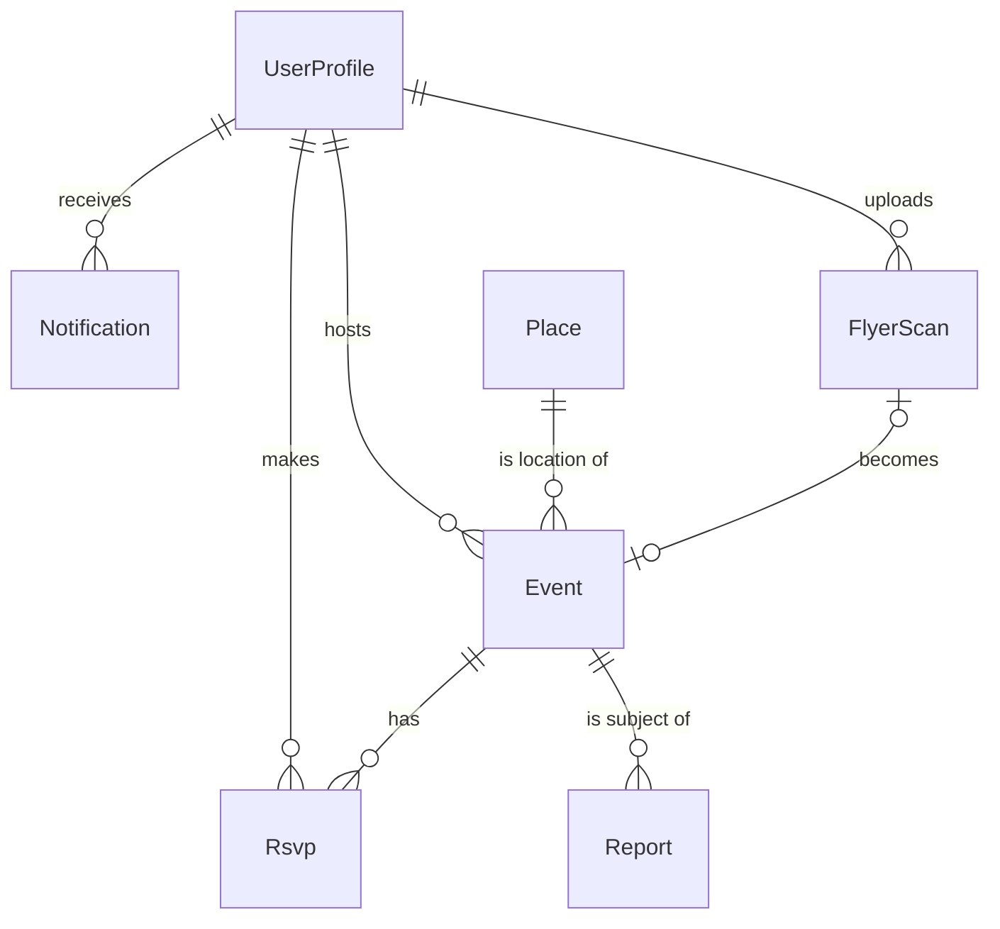

# Data and API

The data models are declared in `amplify/data/resource.ts`. Amplify creates one DynamoDB table per model and generates the GraphQL API, including create, read, update, delete, list, and subscribe operations for each.

## Models

### UserProfile

| Field | Type | Notes |
|---|---|---|
| `id` | ID | The Cognito user ID |
| `displayName` | string | 2 to 30 characters |
| `homePlaceId` | ID | The building they live in |
| `interests` | string[] | From the interest list, minimum three |
| `emailAlerts` | boolean | Default off |
| `status` | `ACTIVE` \| `SUSPENDED` | Set by moderators |

The email address stays in Cognito and is not copied here.

### Place

Seeded from `amplify/data/places.json` and read-only to users.

| Field | Type | Notes |
|---|---|---|
| `id` | ID | Slug, such as `rieber-hall` |
| `name` | string | "Rieber Hall" |
| `aliases` | string[] | "Rieber", "Rieber lobby". Helps flyer extraction match free text |
| `lat`, `lng` | float | |
| `kind` | `RESIDENCE` \| `DINING` \| `COMMONS` \| `OUTDOOR` \| `REC` | |

The team compiles this list by hand, about 30 entries. A starting set to verify: Rieber Hall, Rieber Terrace, Rieber Vista, Hedrick Hall, Hedrick Summit, Sproul Hall, Sproul Cove, Sproul Landing, Dykstra Hall, De Neve Plaza, Sunset Village, Saxon Suites, Hitch Suites, Olympic Hall, Centennial Hall, Covel Commons, Carnesale Commons, Bruin Plate, Epicuria, The Study at Hedrick, Rendezvous, Sunset Canyon Recreation Center.

### Event

Covers both events and hangouts.

| Field | Type | Notes |
|---|---|---|
| `id` | ID | |
| `kind` | `EVENT` \| `HANGOUT` | |
| `status` | `DRAFT` \| `PUBLISHED` \| `HELD` \| `REMOVED` | `DRAFT` from a flyer scan awaiting review; `HELD` when screening flagged it |
| `title` | string | Up to 80 characters |
| `description` | string | Optional, up to 1,000 characters |
| `placeId` | ID | |
| `placeDetail` | string | Optional: "3rd floor lounge" |
| `startsAt`, `endsAt` | datetime (UTC) | Hangouts default to two hours long |
| `tags` | string[] | From the interest list, one to three |
| `hostId` | ID | Owner |
| `hostName` | string | Copied from the profile at posting time so lists need no second lookup |
| `flyerKey` | string | S3 key, optional |
| `rsvpCount` | int | Maintained by the RSVP mutations |
| `dedupeKey` | string | Normalised title + place + start hour; used to spot the same flyer scanned twice |
| `expiresAt` | epoch seconds | DynamoDB TTL: 24 hours after `endsAt` for hangouts, 30 days for events |

Secondary index: `status` + `startsAt`, so "published posts between now and Friday" is a single query.

### Rsvp

| Field | Type | Notes |
|---|---|---|
| `eventId` + `userId` | composite key | One per user per event |
| `displayName` | string | For the host's attendee list |

Secondary index on `userId` for "my saved events".

### FlyerScan

| Field | Type | Notes |
|---|---|---|
| `id` | ID | |
| `userId` | ID | Owner |
| `s3Key` | string | |
| `status` | `PROCESSING` \| `READY` \| `NOT_A_FLYER` \| `FAILED` | The client subscribes to changes on this record to know when to show the review form |
| `draftEventId` | ID | Set when `READY` |
| `duplicateOfEventId` | ID | Set when an existing event has the same `dedupeKey` |

### Notification

| Field | Type | Notes |
|---|---|---|
| `id` | ID | |
| `userId` | ID | Owner |
| `eventId` | ID | |
| `reason` | string | "Matches your interest: food" |
| `read` | boolean | |
| `expiresAt` | epoch seconds | TTL, 14 days |

### Report

| Field | Type | Notes |
|---|---|---|
| `id` | ID | |
| `eventId`, `reporterId` | ID | |
| `reason` | `SPAM` \| `INAPPROPRIATE` \| `UNSAFE` \| `OTHER` | |
| `note` | string | Optional |
| `resolved` | boolean | |

## Access rules

| Model | Signed-in user | Owner | Moderators | Backend functions |
|---|---|---|---|---|
| UserProfile | Read `displayName` only | Read and update own | Read all, set `status` | Read |
| Place | Read | n/a | n/a | n/a |
| Event | Read where `status` is `PUBLISHED` | Create, update, delete own | Update any | Create drafts, update |
| Rsvp | Read counts | Create and delete own; host reads the list for their event | Read | n/a |
| FlyerScan | None | Create and read own | None | Update |
| Notification | None | Read and update own | None | Create |
| Report | Create | None | Read and update | n/a |

Suspended users are blocked from all create and update operations by a check in a shared AppSync resolver function.

## Custom operations

These are the operations that are not generated CRUD.

| Operation | Type | Input | Returns | Backed by |
|---|---|---|---|---|
| `askHill` | Query | `question: String!`, `history: [ChatTurn]` | `reply: String!`, `events: [Event]` | `askHill` Lambda |
| `eventIcs` | Query | `eventId: ID!` | `.ics` file content as a string | `icsExport` Lambda |
| `publishEvent` | Mutation | `eventId: ID!`, edited fields | `Event` | Resolver: checks ownership, runs screening, sets `PUBLISHED` or `HELD` |
| `toggleRsvp` | Mutation | `eventId: ID!` | `Event` with the new `rsvpCount` | Resolver: a DynamoDB transaction that writes the RSVP and adjusts the count together |
| `moderateEvent` | Mutation | `eventId: ID!`, `action` | `Event` | Resolver, moderators only |

## Real-time behaviour

The client subscribes to:

- **Published events**: created, updated, and deleted, so the map and feed stay live
- **Own FlyerScan**: to move from the "reading your flyer" spinner to the review form
- **Own Notifications**: to show the alert badge

One rule to remember: AppSync subscriptions fire only when a change goes through an AppSync mutation. A Lambda that writes straight to DynamoDB will not trigger them. So `flyerExtract` and `matchAndNotify` write through the GraphQL API using their IAM role, never through the DynamoDB SDK.

## Times

All times are stored in UTC. The client displays them in `America/Los_Angeles` regardless of the device's time zone, since every event is physically on the Hill.

## Calendar files

`eventIcs` returns a standard iCalendar file with one event, including the place name, coordinates, a link back to the event in Hill, and a 30-minute reminder alarm. The stable event ID is used as the calendar UID, so re-downloading after a host edits the event updates the existing calendar entry rather than adding a second one.
